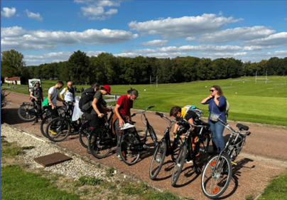

```{r setup, include=FALSE}
options(scipen=6)       
options(digits.secs=6)  
options(knitr.kable.NA = '-') 
options(tinytex.verbose = TRUE)
knitr::opts_chunk$set(
  echo    = FALSE,
  warning = FALSE,
  message = FALSE,
  fig.align = "center",
  fig.pos   = "H",
  eval.after = "fig.cap", # Pour évaluer du code R inline after dans le chunk
  out.extra = "",   # indispensable, sinon bookdown ignore fig.pos
  # dpi=300, # Seument utile si image raster (png)
  dev = "cairo_pdf",fig.path = "rapport_figs/"
)


# Pour intégrer la Police Marianne dans les graphiques/cartes
pacman::p_load(showtext)
font_add("Marianne", 
         regular = "fonts/Marianne/Marianne-Regular.ttf", 
         bold = "fonts/Marianne/Marianne-Bold.ttf", 
         italic = "fonts/Marianne/Marianne-LightItalic.ttf", 
         bolditalic = "fonts/Marianne/Marianne-BoldItalic.ttf", 
         )

showtext_auto() # Activer showtext pour tous les graphiques
showtext_opts(dpi = 300)# Synchroniser showtext avec le DPI de knitr

# Import des paquets pour illustration
pacman::p_load(kableExtra, readxl, palmerpenguins, ggplot2)
```


# Titre 1
## Titre 2
### Titre 3
#### Titre 4

**Appel de figure**   

Lorem ipsum dolor sit amet, consectetur adipiscing elit. Donec arcu nisl, aliquet eu facilisis nec, consectetur vitae justo. In hac habitasse platea dictumst. Pellentesque consequat ex lobortis nulla gravida at feugiat neque aliquam. Curabitur consectetur varius metus ut dapibus. Quisque viverra lectus in orci fringilla suscipit (Figure \@ref(fig:figex)).


```{r figex, fig.cap="PatriNat en sortie de service au Golf de l'Ailette (Aisne) — septembre 2022 © Jean-Baptiste Carriou", out.width="78%"}

```


**Appel de bibliographie**

Aliquam massa odio, placerat id vulputate eget, vehicula nec nisl. Praesent et dolor quis felis fermentum sagittis ultricies sit t est [@holling1978 ; @bruno2026].


**Tableau** 

In hac habitasse platea dictumst. Pellentesque consequat ex lobortis nulla gravida at feugiat neque aliquam. Curabitur consectetur varius metus ut dapibus. Quisque viverra lectus in orci fringilla suscipit (Tableau \@ref(tab:tab-exemple)).

```{r tab-exemple}
knitr::kable(
  head(mtcars[, 1:4], 5),
  caption = "Exemple de tableau — légende au-dessus",
  booktabs = TRUE
) |> 
  kable_styling(latex_options = "HOLD_position")
```

\newpage
**Symboles mathématiques de taille réduite dans le texte**  

Lorem ipsum dolor sit amet, consectetur adipiscing elit. Donec arcu nisl, aliquet eu facilisis nec, consectetur vitae justo. In hac habitasse platea dictumst. Pellentesque consequat $\smalleq{A_{i,norm} \in [0, 1]}$.

\bigskip
**Figure incluant la police Marianne**  

In hac habitasse platea dictumst. Pellentesque consequat ex lobortis nulla gravida at feugiat neque aliquam. Curabitur consectetur varius metus ut dapibus. Quisque viverra lectus in orci fringilla suscipit (Figure \@ref(fig:fig-ex)).


```{r}
# Création du thème Marianne
theme_marianne <- function(base_size = 11,
                           base_family = "Marianne") {

  theme_minimal(
    base_size = base_size,
    base_family = base_family
  ) +
    theme(
      text = element_text(
        family = base_family,
        color = "#161616"
      ),

      plot.title = element_text(
        face = "bold",
        size = rel(1.4),
        color = "#161616"
      ),

      plot.subtitle = element_text(
        size = rel(1),
        color = "#666666"
      ),

      axis.title = element_text(
        face = "bold"
      ),

      axis.text = element_text(
        color = "#3A3A3A"
      ),

      legend.title = element_text(
        face = "bold"
      ),

      legend.position = "bottom",

      panel.grid.minor = element_blank(),

      plot.background = element_rect(
        fill = "white",
        color = NA
      )
    )
}
```


```{r fig-ex, message = FALSE, out.width="80%", fig.cap= "Exemple de graphique avec la police Marianne."}

ggplot(data = penguins, 
       aes(x = flipper_length_mm,
           y = body_mass_g)) +
  geom_point(aes(color = species, 
                 shape = species),
             size = 3,
             alpha = 0.8) +
  scale_color_manual(values = c("darkorange","purple","cyan4")) +
  labs(title = "Penguin size, Palmer Station LTER",
       subtitle = "Flipper length and body mass for Adelie, Chinstrap and Gentoo Penguins",
       x = "Flipper length (mm)",
       y = "Body mass (g)",
       color = "Penguin species",
       shape = "Penguin species") +
  theme(legend.position = c(0.2, 0.7),
        plot.title.position = "plot",
        plot.caption = element_text(hjust = 0, face= "italic"),
        plot.caption.position = "plot")+
  theme_marianne()
```


\newpage
\phantomsection
# Annexes {-}

## Annexe 1 : Liste des acronymes. {#annexe-1-liste-des-acronymes .unnumbered}

```{r , result= "asis"}
read.csv("data/acro.csv", sep = ";")|> 
  knitr::kable(caption = 'Acronymes utilisés',
               longtable = TRUE, 
               escape= FALSE,format = "latex",booktabs = TRUE)  

```

\newpage

\phantomsection 
# Références {-}

